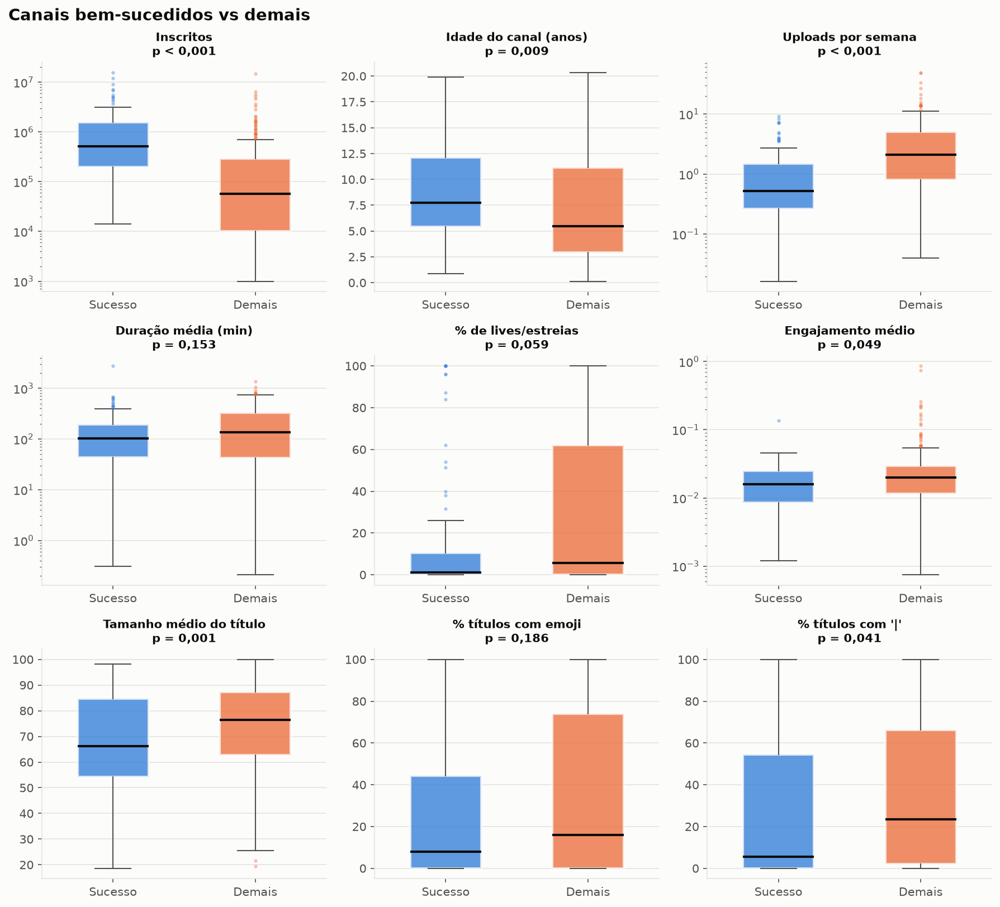
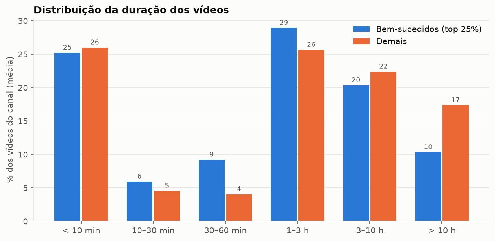
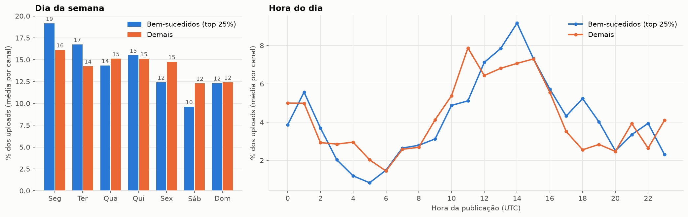
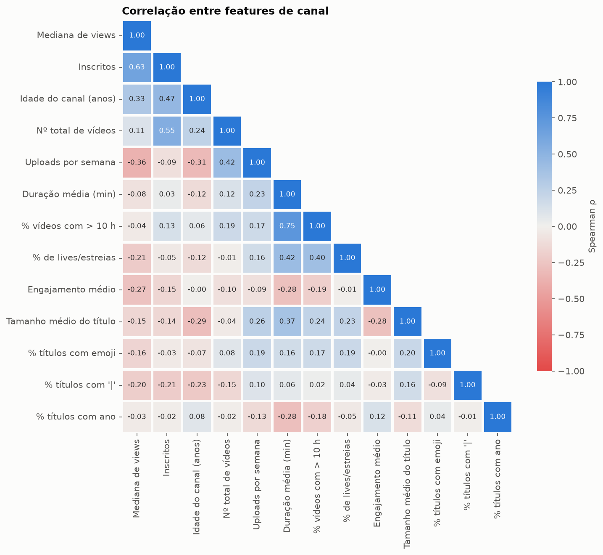
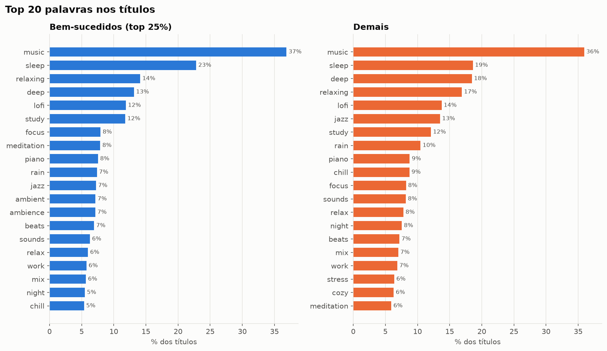

# O que os canais lo-fi / ambiente bem-sucedidos têm em comum?

Análise de **367 canais** e **17.354 vídeos** de lo-fi, ambiente, study e sleep music no YouTube, coletados com a
YouTube Data API v3 e analisados com pandas. O objetivo é descobrir quais padrões separam os canais que mais
performam dos demais.

**Sucesso** = canal no **top 25% em mediana de views por vídeo** (últimos até 50 vídeos). A mediana impede que um
único hit viral defina o canal. Na amostra, isso equivale a **≥ ~15,6 mil views por vídeo** (92 canais).

## Principais resultados

Comparação canal a canal entre os 92 bem-sucedidos e os 275 demais, sempre pela **mediana** de cada grupo.
Os p-valores vêm de um teste de permutação da diferença de medianas (10.000 embaralhamentos). Como são 7 padrões
testados ao mesmo tempo, os p-valores foram ajustados pela correção de **Holm–Bonferroni**. **Padrão** = p ajustado
< 0,05; **tendência** = o resto.

### Padrões

| # | Padrão | Bem-sucedidos | Demais | p-valor | p ajustado |
|---|---|---|---|---|---|
| 1 | **Postam menos**: uploads por semana | 0,53 | 2,1 | < 0,001 | 0,004 |
| 2 | **Títulos mais curtos**: caracteres | 66 | 76 | 0,001 | 0,007 |
| 3 | **Canais mais antigos**: idade em anos | 7,7 | 5,5 | 0,009 | 0,045 |

### Tendências

| # | Tendência | Bem-sucedidos | Demais | p-valor | p ajustado |
|---|---|---|---|---|---|
| 4 | **Menos "\|" no título**: % dos títulos | 5,5% | 23% | 0,04 | 0,16 |
| 5 | **Menos lives/estreias**: % dos vídeos | 1% | 5,7% | 0,06 | 0,16 |
| 6 | **Engajamento proporcional menor**: (likes + comentários) / views | 1,6% | 2,0% | 0,049 | 0,16 |
| 7 | **Menos vídeos ultralongos**: % dos vídeos com > 10 h | 0% | 0% | 1,0 | 1,0 |

As tendências apontam na mesma direção, mas a evidência não resiste à correção. No item 7, cerca de 2/3 dos canais
não têm nenhum vídeo acima de 10 h, então a mediana é 0% nos dois grupos e o teste não detecta diferença. Ela só
aparece na média: 10% do catálogo dos bem-sucedidos contra 17% dos demais.

O padrão 3 está no limite. A correção cobre os 7 candidatos, não as 12 features exploradas no notebook. Aplicada às 12,
uploads por semana e tamanho do título continuam significativos, mas a idade do canal não (p ajustado ≈ 0,08).

**O que não diferenciou os grupos:** emojis no título (p = 0,19), ano no título e número total de vídeos.
O vocabulário também é quase o mesmo: 18 das 20 palavras mais frequentes nos títulos são iguais nos dois grupos.

**Leitura:** o canal de sucesso típico do nicho é antigo, publica pouco (cerca de um vídeo a cada duas semanas) e
usa títulos curtos e diretos. Há indícios, ainda sem significância, de que ele também usa menos "|" nos títulos e
faz menos lives.

> São correlações, não causas. Um canal grande pode postar menos *porque* cada vídeo já rende muito, e não o contrário.

### Gráficos











## Metodologia

**1. Coleta (`src/collect.py`)**
- 16 termos de busca ("lofi hip hop", "chillhop", "sleep music", "rain sounds", "jazz cafe music" etc.).
- Para cada termo, foram feitos três tipos de busca: canais por relevância, canais por views e os 50 vídeos mais vistos.
  Dos vídeos, aproveitamos os canais que os publicaram.
- Detalhes dos canais (`channels.list`) e dos até 50 vídeos mais recentes de cada um (`playlistItems.list` + `videos.list`).
- Filtro: ≥ 1.000 inscritos e ≥ 10 vídeos.
- Coleta incremental: as buscas feitas ficam em `data/raw/search_log.csv` e não são repetidas, o que economiza
  a cota diária de 10.000 unidades. Se a cota acabar no meio, o script salva o que já coletou.

**2. Limpeza e features (`src/clean.py`)**
- Por vídeo: duração, dia e hora (UTC), tamanho do título, emojis, presença de "|", "24/7", "live", "beats to"
  e ano no título, além do engajamento. Quando os likes estão ocultos, o engajamento fica vazio em vez de 0.
- Por canal: média e mediana de views, uploads por semana, % de lives, duração média, idade e engajamento médio.
- **Filtro de nicho:** a busca por vídeos populares também traz canais de fora do nicho (Cocomelon, canais de culinária,
  bandas de metal…). Fica o canal cujo nome tem um termo do nicho ou que tem pelo menos 50% dos vídeos com termos do
  nicho no título ou nas tags. 367 de 414 canais passaram.

**3. Análise (`notebooks/analysis.ipynb`)**
- Features de vídeo (título, duração, lives) agregadas **por canal**, para que canais com mais vídeos não pesem mais.
- Teste de permutação da diferença de medianas para cada feature e correção de Holm–Bonferroni nos 7 padrões candidatos.
- Boxplots, barras, correlação de Spearman e palavras mais frequentes nos títulos de cada grupo.

## Limitações

- **Viés de amostragem:** a busca pelos vídeos mais vistos favorece canais de sucesso. Entre os canais vindos dessa
  busca, 34% caíram no top 25%, contra 13% entre os vindos da busca de canais.
- **Filtro de nicho imperfeito:** alguns canais do nicho foram removidos (ex.: LAKEY INSPIRED) e alguns de fora passaram.
- **"% de lives" inclui estreias (Premieres):** a API marca as duas coisas da mesma forma (`liveStreamingDetails`).
- **Recorte no tempo:** é uma foto dos últimos até 50 vídeos de cada canal, coletada em 22/10/2026.
- A busca de canais da API devolve muitos canais extintos ou minúsculos: dos 2.155 IDs retornados, 1.009 não
  existiam mais.

## Como reproduzir

```bash
python3 -m venv .venv
source .venv/bin/activate
pip install -r requirements.txt

# Chave da YouTube Data API v3
echo "YT_API_KEY=sua_chave" > .env

python src/collect.py    # cerca de 9.000 unidades de cota numa coleta do zero
python src/clean.py
jupyter notebook notebooks/analysis.ipynb
```

Os dados tratados (`data/processed/`) estão no repositório. Dá para abrir o notebook sem chave de API.
Uma coleta nova traz números diferentes, e então as conclusões do notebook e deste README precisam ser revisadas.

## Estrutura

```
data/raw/            # saída bruta da API (não versionada)
data/processed/      # dataset tratado com features
src/collect.py       # coleta via API
src/clean.py         # limpeza, features e filtro de nicho
notebooks/analysis.ipynb
figures/             # gráficos usados neste README
requirements.txt
```

**Stack:** Python 3, google-api-python-client, pandas, matplotlib, seaborn, python-dotenv, isodate, jupyter.
